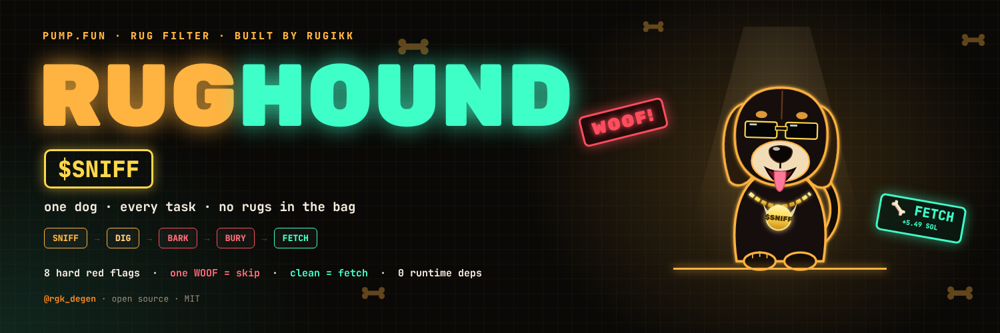
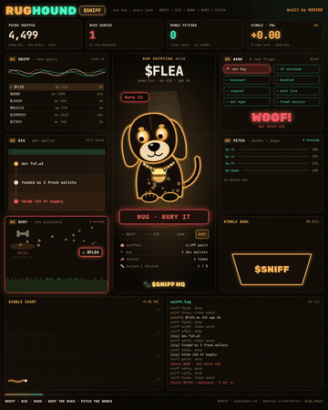
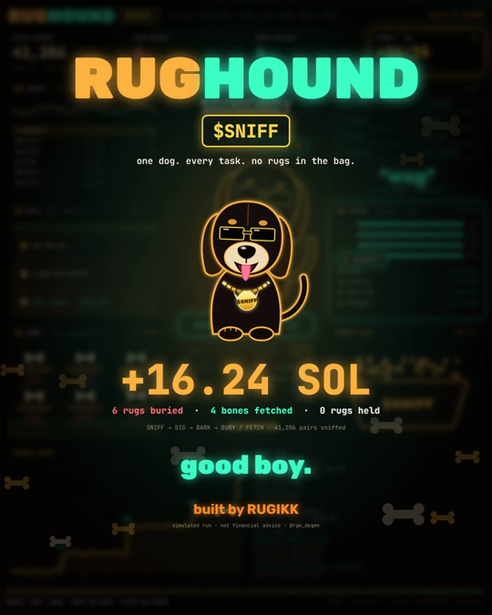

<p align="center"></p>

<h1 align="center">RUGHOUND 🐶 $SNIFF</h1>
<p align="center"><b>One dog runs your pump.fun rug filter.</b><br>
<code>SNIFF → DIG → BARK → BURY / FETCH</code></p>
<p align="center">


</p>
<p align="center">built by RUGIKK · <a href="https://x.com/rgk_degen">@rgk_degen</a></p>

---

## Meet Sniff

Sniff is a hound with a gold chain and one job: **keep rugs out of your bag.**

Most new pump.fun coins don't make it. In May 2025 Solidus Labs reported that about **98.6%** of tokens launched there showed rug-pull or pump-and-dump patterns ([CoinDesk](https://hotfix.coindesk.com/business/2025/05/07/98-of-tokens-on-pump-fun-have-been-rug-pulls-or-an-act-of-fraud-new-report-says)). So Sniff doesn't hunt for moonshots. He says **no** fast, and only fetches what passes every check.

<p align="center"></p>

## Episodes

| episode | file | run (simulated) |
|---|---|---|
| RUGHOUND terminal | `terminal/index.html` | 6 buried · 4 fetched |
| **SNIFF K9 · pump.fun customs** — every coin is a suitcase on the belt: x-ray, sniff, SEIZED or CLEARED | `terminal/k9.html` | 6 seized · 4 cleared · +15.70 SOL |
| **SNIFF DIGS · pump.fun backyard** — every coin is a fresh mound: Sniff digs it up, rugs get a tombstone, clean coins become golden bones | `terminal/dig.html` | 6 buried · 4 fetched · +17.20 SOL |

## Five tasks, one dog

| task | what Sniff does |
|---|---|
| 🐽 **01 SNIFF** | picks up every new pair, checks the scent: holders, concentration, socials age |
| ⛏ **02 DIG** | digs under the dev wallet: wallet age, where it was funded from, past rugs |
| 📣 **03 BARK** | runs 11 hard red flags. **One WOOF = the coin is out** |
| 🦴 **04 BURY** | rugs go to the backyard, with the reason on the bone |
| 🎾 **05 FETCH** | clean coin and confidence ≥ 0.85 → 0.5 SOL in, tp 2× / 4× / 9×, sl −35% |

### The 11 WOOFs

dev bag > 10% · LP unlocked · honeypot tax · bundled > 50% · copycat · mint live · freeze live · bot hype > 85% · socials < 10 min · top-10 > 60% · serial rugger

Rules and reasons: **[docs/RED_FLAGS.md](docs/RED_FLAGS.md)**

### Guardrails

5 SOL spend cap per session · fixed 0.5 SOL size · no holding through an LP unlock · no auto-posting

## Run it

```bash
git clone https://github.com/rgkdegen/rughound
cd rughound

node src/sniff.js           # run Sniff on 10 demo pairs
npm test                    # every flag + the gate (no install needed)
open terminal/index.html    # watch the terminal live in the browser

# export the clip / banner (needs Playwright + ffmpeg)
npm i
npm run render              # → rughound.mp4 (1080×1350, 30 fps)
npm run banner              # → assets/banner.png
```

```
  U・ᴥ・U  RUGHOUND · $SNIFF · gate 0.85

  sniff> BURY   $FLEA      0     dev holds 41%
  sniff> FETCH  $BONE      0.98  ape 0.5 SOL · tp 2x/4x/9x · sl -35%
  sniff> BURY   $LEASH     0     LP unlocked
  sniff> BURY   $MUZZLE    0     99% sell tax
  sniff> FETCH  $ZOOMIES   0.98  ape 0.5 SOL · tp 2x/4x/9x · sl -35%
  sniff> BURY   $STRAY     0     68% bundled
  sniff> BURY   $CATNIP    0     copycat of $SNIFF
  sniff> FETCH  $BELLYRUB  0.97  ape 0.5 SOL · tp 2x/4x/9x · sl -35%
  sniff> BURY   $TICK      0     mint still live
  sniff> FETCH  $GOODBOY   0.98  ape 0.5 SOL · tp 2x/4x/9x · sl -35%

  6 buried · 4 fetched · spent 2.0/5 SOL · good boy
```

## Repo layout

```
src/sniff.js          sniff → dig → bark → bury / fetch
data/pairs.json       10 demo token snapshots
test/                 flag + gate tests (node --test)
terminal/index.html   the animated RUGHOUND terminal
scripts/              render.js (MP4) · banner.js
docs/                 RED_FLAGS · ROADMAP
assets/               banner, preview, fonts
```

## Roadmap

Live pump.fun feed · on-chain mint/freeze/LP reads · dev memory for buried devs · bundle detection by funder · Telegram alerts · paper trading. Full list: **[docs/ROADMAP.md](docs/ROADMAP.md)**

## FAQ

**Does it trade real money?** Not yet. It reads snapshots from a file and never touches a wallet. The PnL in the video is a scripted demo run.

**Why a dog?** Rug checks are boring. A dog that barks at rugs isn't.

**Can I add a flag?** Add one line to `FLAGS` in `src/sniff.js` and a case in the test.

---

<p align="center"></p>
<p align="center"><sub>MIT · educational project · not financial advice · good boy 🐶</sub></p>
